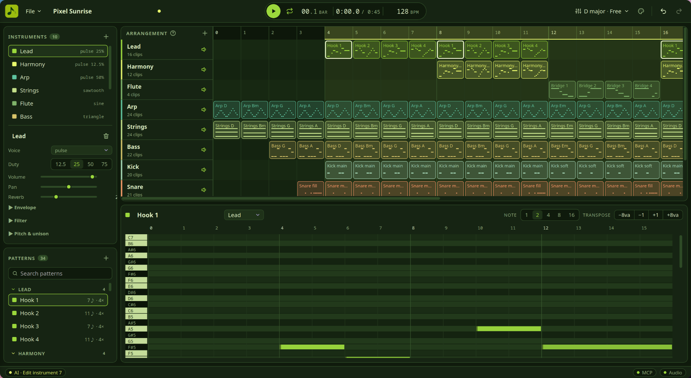

<div align="center">

<picture>
  <source media="(prefers-color-scheme: dark)" srcset="assets/brand/soundbit-lockup-dark.svg">
  
</picture>

**A chiptune workstation for humans and AI agents.**

Compose 8-bit and 16-bit music in a tracker-style editor, or let an AI agent write it for you
through the Model Context Protocol. Both work on the same song at the same time: what the agent
writes appears in the editor as it happens, and every change can be undone.

[](https://github.com/RenasDemirbas/SoundBit/actions/workflows/ci.yml)
[](LICENSE)


**[Install](#install)** · **[What you get](#what-you-get)** · **[AI agents](#compose-with-an-ai-agent)** ·
**[Tools](#mcp-tools)** · **[Wiki](https://github.com/RenasDemirbas/SoundBit/wiki)** · **[Changelog](CHANGELOG.md)**

</div>

<p align="center">
  
</p>

> [!NOTE]
> SoundBit is **pre-alpha**. The editor, live playback, sound shaping, the MCP server and WAV
> export work; expect rough edges and breaking changes until 1.0.

## What you get

- **A tracker-style editor.** One-bar patterns placed on tracks; a canvas arrangement view and
  piano roll; instruments, song settings, transport, undo and redo; five colour themes.
- **Chip voices.** Pulse with four duty cycles, NES-style stepped triangle, sawtooth, sine,
  LFSR noise (long and metallic), Game Boy-style 4-bit wavetables and 4-operator YM2612-style FM
  with eight algorithms.
- **Sound shaping.** Pitch envelopes for kicks, toms and lasers; delayed vibrato; up to four
  detuned unison layers for strings and choirs; a resonant low-, high- and band-pass filter that
  can follow the envelope; and a shared reverb room with a send per instrument.
- **32 presets.** Orchestral strings, brass, choir and timpani, a drum kit, chip leads and basses,
  FM keys and effects, stored as plain JSON in [`assets/presets`](assets/presets).
- **Chip profiles.** Optionally keep a song within what an NES, Game Boy, Commodore 64 or
  Genesis could play: track count, voice types per channel and notes at once.
- **An MCP server with 30 tools.** Agents create instruments, write whole patterns in one call,
  lay out a full arrangement in another, render to WAV and get the level of every track back, so
  they can balance a mix they cannot hear.
- **Bit-exact audio.** The same song renders to the same samples on every platform. No sound
  depends on your operating system's math library.

## Safe by design

- **Local only.** The MCP endpoint listens on `127.0.0.1`. Requests from other machines, from
  websites in your browser (any `Origin` header) and with foreign `Host` headers are refused.
- **A sandbox for agents.** Agents only read and write files inside one workspace folder;
  absolute paths, `..` and symlinks out of it are rejected.
- **Undo anything.** Every change, yours or an agent's, is one step in the history. Agent steps
  are labelled `AI:`.
- **Nothing phones home.** No telemetry, no accounts, no update checks.

## Install

There are no prebuilt releases yet; SoundBit builds from source in a few minutes.

You need a stable [Rust](https://rustup.rs) toolchain and [Node.js](https://nodejs.org) 22 or
newer. On Linux, also install the ALSA and WebKitGTK development packages:

```sh
# Debian / Ubuntu
sudo apt-get install -y libasound2-dev libwebkit2gtk-4.1-dev libsoup-3.0-dev \
  libjavascriptcoregtk-4.1-dev librsvg2-dev libayatana-appindicator3-dev
```

```sh
git clone https://github.com/RenasDemirbas/SoundBit.git
cd SoundBit/apps/desktop
npm install
npm run tauri dev          # run the desktop app
npm run tauri build        # or build an installer for your platform
```

The command-line tool renders, plays and inspects projects without the editor, and runs a
headless MCP server:

```sh
cargo install --path crates/soundbit-cli      # installs `soundbit`
soundbit play examples/songs/pixel-sunrise.sbproj
soundbit render examples/songs/clash-of-banners.sbproj -o clash.wav
soundbit info examples/songs/first-light.sbproj
```

## Compose with an AI agent

**With the desktop app open**, SoundBit serves MCP over streamable HTTP at
`http://127.0.0.1:7413/mcp` (shown in the status bar; `SOUNDBIT_MCP_PORT` changes the port).
Register it with your MCP client as an HTTP server. The agent's workspace is the `SoundBit`
folder in your Music directory.

```jsonc
// Most MCP clients accept a configuration like this
"soundbit": { "type": "http", "url": "http://127.0.0.1:7413/mcp" }
```

**Without the app**, `soundbit mcp` serves the same tools over stdio, with its own song and a
workspace of your choice:

```jsonc
"soundbit": {
  "command": "soundbit",
  "args": ["mcp", "--root", "/path/to/your/music/folder"]
}
```

Then ask for music:

> Make an exciting, orchestral-sounding battle theme for my game: D minor, 160 bpm, with brass,
> strings, timpani and a loop I can play forever.

> Write an upbeat chiptune song for my game's title screen: a catchy pulse-lead hook, D major,
> around 128 bpm, with a loop I can repeat.

> Put this song on the NES profile and fix whatever it complains about.

The two example songs [`clash-of-banners`](examples/songs/clash-of-banners.sbproj) and
[`pixel-sunrise`](examples/songs/pixel-sunrise.sbproj) were composed exactly like that.

## MCP tools

Each tool's schema describes its parameters, units and ranges; agents read them on their own.

| Area | Tools |
|---|---|
| Song | `song_get`, `song_new`, `song_open`, `song_save`, `song_update` (tempo, grid, swing, key, chip profile, loop, reverb room), `files_list` |
| Instruments | `preset_list`, `instrument_add_preset`, `instrument_add`, `instrument_update`, `instrument_remove` |
| Patterns | `pattern_create`, `pattern_get`, `pattern_set_notes`, `pattern_add_notes`, `pattern_remove_notes`, `pattern_transpose`, `pattern_duplicate`, `pattern_update`, `pattern_remove` |
| Arrangement | `track_add`, `track_update`, `track_remove`, `arrangement_place`, `arrangement_place_many`, `arrangement_clear` |
| Output | `export_wav` (with peak and RMS per track) |
| History | `history_undo`, `history_redo` |
| Reference | `reference_get` (note format, voices, sound shaping, chip profiles, scales, limits) |

Read tools return compact text views as well: a tracker grid per pattern and an arrangement grid
with tracks as rows and bars as columns.

## Chip profiles

| Profile | Channels |
|---|---|
| Free | Up to 16 tracks, any voice, chords allowed |
| NES | Pulse 1, Pulse 2, Triangle, Noise |
| Game Boy | Pulse 1, Pulse 2, Wave, Noise |
| Commodore 64 | Three voices: pulse, triangle, sawtooth or noise |
| Genesis / Mega Drive | FM 1–6, PSG 1–3, PSG Noise |

Profiles are soft constraints: the song tells you what breaks the rules and why, and edits that
would add new problems are refused with an explanation.

## How it works

```
 Desktop editor (Tauri + Svelte)     MCP client (stdio or HTTP)      soundbit CLI
              │                               │                         │
              └────────────────┬──────────────┴─────────────────────────┘
                               ▼
                    soundbit-app: commands, undo/redo, sessions, presets
                               │
        ┌──────────────────────┼──────────────────────────┐
        ▼                      ▼                          ▼
  soundbit-core          soundbit-engine            soundbit-formats
  song model and         sequencer, voices,         .sbproj files, presets,
  chip profiles          mixer, real-time player    WAV export
                               │
                               ▼
                         soundbit-dsp
                         oscillators, FM, filter, reverb (no_std)
```

Every edit, from a click in the piano roll or from an agent, is a command executed against one
shared session. The audio thread never allocates or locks: songs are compiled into schedules
off the audio thread and handed over through lock-free queues. Project files (`.sbproj`) are
readable, versioned JSON. The design decisions are recorded in [`docs/adr`](docs/adr).

## Documentation

The **[Wiki](https://github.com/RenasDemirbas/SoundBit/wiki)** covers getting started, the editor,
sound design and presets, chip profiles, connecting AI agents, the project file format and the
architecture.

## Development

Contributions are welcome: see [CONTRIBUTING.md](CONTRIBUTING.md), and [SECURITY.md](SECURITY.md)
for reporting a vulnerability privately.

```sh
cargo fmt --all --check
cargo clippy --workspace --all-targets -- -D warnings
cargo test --workspace
cargo xtask check          # crate dependency rules and file-size limits
cd apps/desktop && npm run check && npm run lint && npm test
```

<details>
<summary><b>What the tests cover</b></summary>

| Area | Tests |
|---|---|
| Domain model | Property tests for validation and JSON round trips |
| DSP | Frequency and level accuracy, filter responses, reverb tails, no NaN or infinity |
| Engine | Golden-audio hashes that pin the rendered output; a counting allocator proves the audio path never allocates |
| Application | Every command undoes and redoes exactly; every preset renders audibly without clipping; every example song loads and renders |
| Formats | Save and load round trips; migration of version 1 project files |
| MCP | End-to-end sessions over an in-memory transport; tool schema snapshots; HTTP host and origin protection |
| Desktop | Stores, IPC types and canvas geometry with Vitest |

</details>

## Acknowledgements

SoundBit's simple song model is inspired by
[Bosca Ceoil](https://github.com/TerryCavanagh/boscaceoil) by Terry Cavanagh. The reverb follows
the structure of Jezar's public-domain Freeverb, and the filter Andrew Simper's trapezoidal
state-variable filter; see [THIRD_PARTY_NOTICES.md](THIRD_PARTY_NOTICES.md).

## License

Copyright (C) 2026 Renas Demirbas

SoundBit is free software: you can redistribute it and/or modify it under the terms of the
[GNU General Public License](LICENSE) as published by the Free Software Foundation, either version 3
of the License, or (at your option) any later version. It is distributed in the hope that it will be
useful, but without any warranty; see the license for details.

Music you make with SoundBit is yours: the license covers the program, not your songs.
